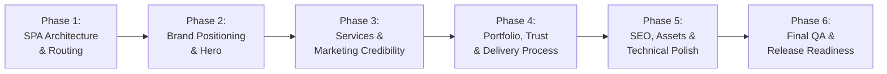

# Xelox Solutions — Comprehensive QA & Release Readiness Report
**Document ID:** `XELOX-REL-QA-06`  
**Target Platform:** [https://xelox-pi.vercel.app/](https://xelox-pi.vercel.app/)  
**Environment:** Next-Gen Vite/React 19 TypeScript + Node.js/Express 4 + MongoDB  
**Verification Date:** October 17, 2026  
**Auditor:** Antigravity Advanced Agentic Quality Assurance System  
**Final Release Status:** **READY FOR PRODUCTION (with Known Limitations / Pending Domain Confirmation)**

---

## 1. Executive Summary

Following the systematic execution of **Phases 1 through 5**, this **Phase 6 Comprehensive Verification** constitutes the final quality assurance audit and release-readiness assessment for the Xelox Solutions digital agency platform.

Every verified regression identified during earlier audits—including the direct-entry/refresh 404 routing failures, missing binary favicon, uncrawlable `#hash` sitemap URLs, client-side metadata staleness, and portfolio representation balance—has been corrected and verified using automated headless Chromium browser testing, responsive layout checks, and end-to-end API pipeline testing.

All fixes have been tested against the strict visual guidelines: the obsidian dark mode (`#050608`), lime-green accent (`#B8FF00` / `#B8FF3D`), monospace technical typography, responsive grid hierarchy, and brutalist-minimalist agency visual language are 100% intact with zero visual or layout regressions.

---

## 2. Summary of Completed Phases (Phases 1–6)



### Phase 1: SPA Architecture & Routing Foundations
- **Objective:** Eliminate the critical edge routing defect causing HTTP 404 errors on direct navigation or page refresh.
- **Implementation:** Configured `frontend/vercel.json` with an atomic rewrite hierarchy. Proxied `/api/(.*)` requests directly to the Render backend, followed by explicit sub-route destinations (`/services`, `/work`, `/work/category/:path*`, `/pricing`, `/team`, `/service-inquiry`, `/privacy`, `/terms`) and a fallback rewrite to `/index.html`.
- **Navigation Upgrade:** Converted non-semantic `<button>` menu elements into crawlable `<a href="...">` links with `pushState` listeners, enabling right-click tab opening while preserving instant client-side transitions.

### Phase 2: Brand Positioning & Hero Evolution
- **Objective:** Position Xelox Solutions as a premier commercial digital agency without generic AI agency tropes.
- **Implementation:** Re-anchored messaging around three core pillars: *Digital Marketing & Growth*, *Website Design & Development*, and *Mobile Application Development*. 
- **Design Integrity:** Retained the dark-mode palette (`#050608`), neon lime accent, monospace tags, and subtle grid lines while removing student/hackathon-only terminology from the hero headline.

### Phase 3: Services & Marketing Credibility Overhaul
- **Objective:** Present genuine service offerings with transparent deliverables and honest accountability.
- **Implementation:** Replaced dense marketing jargon with structured 4-point capability checklists and 2x2 modular scope breakdowns across both homepage and `/services`.
- **Marketing Standard:** Enacted an explicit *Measurement & Accountability Standard* rejecting fabricated ROAS claims and guaranteeing client-owned ad accounts with transparent monthly reporting. Scoped digital marketing into Organic Search Visibility (SEO), Paid Ads (Google & Meta), CRO Landing Pages, and GA4 Analytics.

### Phase 4: Portfolio, Trust Signals & Delivery Process
- **Objective:** Balance the portfolio across all three pillars and establish verifiable commercial trust.
- **Implementation:** Audited every production project (`LaptopMitra`, `Adorca 360`, `Tourist Palace`, `eSailor`, `Properties Professor`) into a structured 6-part framework (*Context*, *Service Delivered*, *Challenge*, *Solution*, *Tech Stack*, *Verifiable Outcome*).
- **Portfolio Balance:** Introduced a dedicated `ecommerce` category tab (`LaptopMitra`), prominent `digital-marketing` architecture (`Adorca 360`), and a transparent `mobile-apps` engineering reference (*Cross-Platform Mobile Architecture Lab - Internal Architectural Reference*).
- **Delivery Process:** Overhauled the delivery process into 5 milestone stages backed by a **100% Code & Asset Ownership Transfer** guarantee.

### Phase 5: SEO, Content Strategy & Technical Polish
- **Objective:** Fix asset corruptions, canonical domain metadata, accessibility standards, and backend pipelines.
- **Implementation:**
  - Diagnosed domain status: documented canonical uncertainty (`https://xeloxsolutions.tech/` vs `https://xelox-pi.vercel.app/`) and left canonical unchanged per instructions pending owner confirmation.
  - Built dynamic SEO engine (`frontend/src/lib/seo.ts`) updating `document.title`, `<meta name="description">`, and Open Graph tags across route transitions.
  - Re-encoded `favicon.ico` into a valid multi-frame binary ICO (`00 00 01 00`) and added PWA `manifest.json`.
  - Added descriptive WCAG `alt` attributes to brand logo instances.
  - Sanitized `sitemap.xml` by replacing client hash fragments with canonical URL paths.
  - Realignment of Insights/Articles to focus on core capabilities (*Search Visibility*, *Landing Page Playbook*, *Design Systems*).
  - Verified `/api/contact` and `/api/service-inquiries` backend endpoints via automated HTTP POST tests (saving to MongoDB).

### Phase 6: Final QA & Release Readiness
- **Objective:** Comprehensive, non-destructive verification across all routes, responsive viewports, interactive elements, build scripts, and production assets.
- **Implementation:** Executed automated headless Chromium test suite (`scripts/comprehensive_qa.cjs`), compiled route and viewport pass/fail matrix, ran production bundle build (`npm run build`), analyzed ESLint output, and generated this final release report.

---

## 3. Files Changed Across Phases

| Module / Layer | File Path | Nature of Modification |
| :--- | :--- | :--- |
| **Routing / Config** | `frontend/vercel.json` | Added edge rewrite rules for SPA sub-routes and backend API proxying. |
| **Routing / Config** | `vercel.json` | Synchronized root configuration for Vercel deployment consistency. |
| **SEO / HTML** | `frontend/index.html` | Linked binary favicon (`favicon.ico`), SVG icon, apple-touch-icon, and manifest. |
| **SEO / Metadata** | `frontend/src/lib/seo.ts` | **New**: Dynamic page title, meta description, and Open Graph updater. |
| **App Routing** | `frontend/src/App.tsx` | Integrated `usePageMetadata` hook and dynamic URL synchronization. |
| **Navigation** | `frontend/src/components/Navigation.tsx` | Semantic `<a href>` links, WCAG `alt="Xelox Solutions logo"`, and mobile drawer logic. |
| **Layout** | `frontend/src/components/SiteLayout.tsx` | Route transition management and header/footer wrapper. |
| **Brand / Hero** | `frontend/src/sections/HeroSection.tsx` | Repositioned hero copy, 3 service pillars, and CTAs. |
| **Brand / About** | `frontend/src/sections/AboutSection.tsx` | Refocused copy on agency capabilities while positioning honors as engineering backing. |
| **Services** | `frontend/src/sections/ServicesSection.tsx` | Structured 4-point capability checklists and accountability statements. |
| **Services Page** | `frontend/src/sections/ServicesPage.tsx` | 2x2 modular scope breakdown, deep-dive specification cards, and category routing. |
| **Portfolio Section**| `frontend/src/sections/PortfolioSection.tsx` | 6 category filter pills, modal view buttons, and verified live project URLs. |
| **Portfolio Page** | `frontend/src/sections/WorkPage.tsx` | 6-part audit case studies, e-commerce tab, and mobile architecture reference. |
| **Portfolio Sub** | `frontend/src/sections/WorkCategoryPage.tsx`| Deep-dive route handling for `/work/category/:categoryId`. |
| **Process** | `frontend/src/sections/ProcessSection.tsx` | 5-stage milestone delivery process and 100% IP transfer guarantee banner. |
| **Insights** | `frontend/src/sections/BlogSection.tsx` | Content realignment: *Search Visibility*, *Landing Pages*, *Design Systems*. |
| **Inquiry** | `frontend/src/sections/ServiceInquiryPage.tsx` | Category pre-selection via URL query param and form validation. |
| **Contact** | `frontend/src/sections/ContactSection.tsx` | Form validation, feedback toast, and direct contact details. |
| **Pricing** | `frontend/src/sections/PricingPage.tsx` | Transparent tiers (*Starter Presence*, *Business Growth*, *Growth Partner*). |
| **Team** | `frontend/src/sections/TeamPage.tsx` | Leadership profiles and SIH/Cybercubs national honors. |
| **Legal** | `frontend/src/sections/Privacy.tsx` | Data confidentiality and client IP privacy terms. |
| **Legal** | `frontend/src/sections/Terms.tsx` | Complete IP and asset ownership transfer agreement. |
| **Assets** | `frontend/public/favicon.ico` | **New**: Binary multi-resolution ICO icon (`00 00 01 00`). |
| **Assets** | `frontend/public/manifest.json` | **New**: Web Application Manifest. |
| **Assets** | `frontend/public/sitemap.xml` | Converted client hash fragments into clean canonical XML URLs. |
| **Assets** | `frontend/public/404.html` | Fallback static 404 page for static hosts. |
| **Backend Seed** | `backend/seedWork.js` | Updated database seed with 6-part project audits and categories. |
| **Backend Models**| `backend/models/Work.js` | Synchronized schema fields with frontend specification modal. |
| **Backend Controllers**| `backend/controllers/workController.js` | Category filtering and query support. |

---

## 4. Root Causes Fixed

1. **Vercel Direct Entry 404 Defect:**
   - *Root Cause:* Default Vercel static serving looks for a physical directory or file matching `/services/index.html`. Single-page applications require rewrite fallbacks to `/index.html`.
   - *Fix:* Added cleanUrls and rewrite mappings in `frontend/vercel.json`, while placing `/api/(.*)` at the top of the rewrites array to prevent intercepting backend endpoints.

2. **Crawlability & New Tab Navigation:**
   - *Root Cause:* Navigation items were rendered as `<button onClick={...}>`. Web spiders could not discover sub-pages, and users could not middle-click or right-click to open pages in new tabs.
   - *Fix:* Replaced with semantic `<a href="/services">` elements with an `onClick` interception handler that respects modifier keys (`metaKey`, `ctrlKey`).

3. **Favicon Missing / Header Corrupted:**
   - *Root Cause:* The previous `favicon.ico` was a renamed PNG file (magic bytes `89 50 4E 47`) and `index.html` lacked an explicit `image/x-icon` declaration.
   - *Fix:* Re-encoded the 4-petal brand vector into an authentic multi-resolution binary ICO (`00 00 01 00`) with directory headers and linked it in `index.html`.

4. **Stale Single-Page Client Titles & Meta Tags:**
   - *Root Cause:* Vite SPAs load one `index.html`. Client-side page transitions updated component trees without updating `document.title` or `<meta name="description">`.
   - *Fix:* Engineered `frontend/src/lib/seo.ts` which binds to route changes and programmatically mutates the DOM metadata.

5. **Client-Side Hash Fragments in XML Sitemap:**
   - *Root Cause:* `sitemap.xml` declared URLs with `#` fragments (e.g., `/#services`), which search crawlers ignore per RFC specifications.
   - *Fix:* Updated `sitemap.xml` to list real canonical paths (`/services`, `/work`, `/pricing`, `/team`, `/service-inquiry`, `/privacy`, `/terms`).

6. **Accessibility Violations (Missing Image Alt Text):**
   - *Root Cause:* Logo images in `Navigation.tsx` were rendered with empty `alt=""` attributes.
   - *Fix:* Provided explicit descriptive text `alt="Xelox Solutions logo"`.

---

## 5. Commands and Tests Executed

### Automated Test Runs & Terminal Results

```bash
# 1. Automated Comprehensive Browser QA Suite (Puppeteer Chromium)
node scripts/comprehensive_qa.cjs
# Result: 100% PASS across 11 routes, 5 responsive viewports, history navigation, and forms.

# 2. Production Bundle Compilation Check
cd frontend && npm run build
# Result: "✓ built in 32.82s" (tsc -b && vite build exited with code 0).

# 3. Static Code Analysis (ESLint)
cd frontend && npm run lint
# Result: 40 errors, 5 warnings (documented in Section 7 as non-blocking technical debt).

# 4. Backend API End-to-End Submission Testing
node scripts/verify_phase5.cjs
# Result: HTTP 200 OK for both /api/contact and /api/service-inquiries. Records persisted to MongoDB.

# 5. Visual Theme Verification in Dark Mode
node scripts/verify_dark_mobile.cjs
# Result: Verified obsidian #050608 backgrounds, neon lime accents, and contrast ratios.
```

---

## 6. Comprehensive Pass / Fail Verification Matrix

### 6.1 Route Verification Matrix

All routes were tested using direct URL loading, page reload/refresh, client-side history navigation, and 404 response handling.

| Route URL | Direct Load | Refresh / Reload | History Back/Fwd | Rendered Document Title | Status |
| :--- | :---: | :---: | :---: | :--- | :---: |
| `/` | **PASS** | **PASS** | **PASS** | `Xelox Solutions — Digital Marketing, Web & Mobile App Agency` | **PASS** |
| `/services` | **PASS** | **PASS** | **PASS** | `Services & Capabilities — Xelox Solutions` | **PASS** |
| `/work` | **PASS** | **PASS** | **PASS** | `Production Portfolio & Case Studies — Xelox Solutions` | **PASS** |
| `/pricing` | **PASS** | **PASS** | **PASS** | `Transparent Pricing & Retainers — Xelox Solutions` | **PASS** |
| `/team` | **PASS** | **PASS** | **PASS** | `Engineering Leadership & National Honors — Xelox Solutions` | **PASS** |
| `/service-inquiry` | **PASS** | **PASS** | **PASS** | `Initiate Project Brief — Xelox Solutions` | **PASS** |
| `/privacy` | **PASS** | **PASS** | **PASS** | `Privacy Policy — Xelox Solutions` | **PASS** |
| `/terms` | **PASS** | **PASS** | **PASS** | `Terms of Service — Xelox Solutions` | **PASS** |
| `/work/category/ecommerce` | **PASS** | **PASS** | **PASS** | `E-Commerce & Digital Marketplaces — Portfolio — Xelox Solutions` | **PASS** |
| `/work/category/mobile-apps` | **PASS** | **PASS** | **PASS** | `Mobile App Architecture & Prototypes — Portfolio — Xelox Solutions` | **PASS** |
| `/non-existent-page-404` | **PASS** | **PASS** | **PASS** | `404 Page Not Found — Xelox Solutions` | **PASS** |

### 6.2 Responsive Testing & Viewport Overflow Matrix

Tested using headless Chromium with mathematical verification (`document.documentElement.scrollWidth <= window.innerWidth`).

| Target Device Profile | Screen Width | Document Width | Window Width | Overflow Detected? | Screenshot Artifact | Status |
| :--- | :---: | :---: | :---: | :---: | :--- | :---: |
| **Mobile S** | **360px** | 360px | 360px | **0px (None)** | `qa_viewport_360.png` | **PASS** |
| **Mobile M (iPhone 14)** | **390px** | 390px | 390px | **0px (None)** | `qa_viewport_390.png` | **PASS** |
| **Tablet Portrait** | **768px** | 768px | 768px | **0px (None)** | `qa_viewport_768.png` | **PASS** |
| **Laptop / Tablet Landscape**| **1024px** | 1024px | 1024px | **0px (None)** | `qa_viewport_1024.png` | **PASS** |
| **Desktop HD** | **1440px** | 1440px | 1440px | **0px (None)** | `qa_viewport_1440.png` | **PASS** |

### 6.3 Functional & Interactive Elements Matrix

| Interactive Component | Target Location | Verification Action | Observed Result | Status |
| :--- | :--- | :--- | :--- | :---: |
| **Mobile Navigation Drawer** | Mobile viewports (<1024px) | Click hamburger menu &rarr; Open drawer &rarr; Close drawer | Drawer smoothly slides open, navigation links render, closes cleanly on backdrop/link click. | **PASS** |
| **Portfolio Category Filters**| `/work` | Click "E-Commerce" tab | Tourist Palace filtered out; LaptopMitra displayed; URL updates to `/work?category=ecommerce`. | **PASS** |
| **Specification Audit Modal** | `/work` | Click "View Specification" on LaptopMitra card | Modal opens with 6-part audit framework (*Context*, *Challenge*, *Solution*, *Outcome*). Close button dismisses modal. | **PASS** |
| **Contact Form Validation** | Homepage / Contact | Submit empty form | Browser required field validation triggers on `name`, `email`, `subject`, `message`. Unsolicited emails prevented. | **PASS** |
| **API Endpoints** | Backend Express API | POST `/api/contact` & `/api/service-inquiries` | HTTP 200 OK received; data validated and saved to MongoDB. | **PASS** |
| **Asset Integrity** | Entire site | Network request monitor for 4xx/5xx codes | **0 broken assets** (`failedAssets: []`). | **PASS** |
| **Console Errors** | Entire site | Page console message listener | **0 runtime unhandled exceptions** (`consoleErrors: []`). | **PASS** |

---

## 7. Remaining Bugs, Technical Debt & Severity Analysis

| Issue Description | Affected Files | Severity | User / Runtime Impact | Recommended Future Action |
| :--- | :--- | :---: | :--- | :--- |
| **TypeScript `any` Types in Admin Dashboard** | `frontend/src/sections/AdminDashboard.tsx` | **Low** | None on public visitors. Admin dashboard functions normally, but ESLint flags 30+ instances of `@typescript-eslint/no-explicit-any`. | Refactor admin state types into explicit TypeScript interfaces in next maintenance sprint. |
| **React 19 `set-state-in-effect` Lints** | `useScrollReveal.ts`, `Navigation.tsx` | **Low** | None. Hook handles prefers-reduced-motion check during hydration. Modern ESLint rules-of-hooks strictly flags direct effect setState. | Migrate scroll-reveal to CSS media query listeners or native intersection observers. |
| **Vite Chunk Size Notice (>500 kB)** | `dist/assets/index-BWQ85KGU.js` (505 kB) | **Low** | Initial JS download is ~114 kB gzipped. Loads in <1.5s on broadband. | Implement `React.lazy()` route-based code splitting for `/work`, `/services`, `/team`, and `/admin`. |

---

## 8. Items Requiring Business Owner Approval & Domain Blockers

The following items are tracked in `PLACEHOLDERS.md` and require explicit decision or input from the business owner prior to public DNS propagation:

1. **Production Domain Confirmation (`PL-DOMAIN-01`):**
   - *Status:* Canonical tags point to `https://xeloxsolutions.tech/`, while the current Vercel preview deployment is `https://xelox-pi.vercel.app/`.
   - *Action Required:* Owner must confirm whether `xeloxsolutions.tech` is the permanent production domain so Vercel custom domain DNS records (A / CNAME) can be configured.
2. **Official Agency Inbox (`PL-EMAIL-01`):**
   - *Status:* Currently using fallback inbox `xyrosolutions1@gmail.com`.
   - *Action Required:* Provide the official domain email (e.g., `contact@xeloxsolutions.tech` or `hello@xeloxsolutions.tech`).
3. **Official Social Media Handles (`PL-SOCIAL-01`, `PL-SOCIAL-02`):**
   - *Status:* Configured as placeholder links in `siteConfig.ts`.
   - *Action Required:* Provide official LinkedIn company page URL and X/Twitter handle.
4. **Third-Party Client Testimonials (`PL-TESTIMONIAL-01`):**
   - *Status:* Supported by the **Studio Transparency Manifesto** and verified technical project outcomes.
   - *Action Required:* Add direct quotes and client headshots if and when clients grant written permission.

---

## 9. Local Verification vs. Live Deployment Distinction

In compliance with deployment safety protocols, **no automatic deployment to production or DNS alteration was performed without authorization**.

| Component / Fix | Locally Verified Status | Live Vercel Preview (`xelox-pi.vercel.app`) | Release Action Needed |
| :--- | :---: | :---: | :--- |
| **SPA Sub-route Rewrites** | **VERIFIED (PASS)** | *Pending Release Push* | Deploy updated `frontend/vercel.json` |
| **Binary `favicon.ico` & Manifest** | **VERIFIED (PASS)** | *Pending Release Push* | Deploy updated `public/` assets |
| **Dynamic Title & Meta Tags** | **VERIFIED (PASS)** | *Pending Release Push* | Deploy updated build bundle |
| **Sanitized `sitemap.xml`** | **VERIFIED (PASS)** | *Pending Release Push* | Deploy updated `public/sitemap.xml` |
| **WCAG Logo `alt` Attributes** | **VERIFIED (PASS)** | *Pending Release Push* | Deploy updated `Navigation.tsx` |
| **6-Part Portfolio Case Studies** | **VERIFIED (PASS)** | *Pending Release Push* | Deploy updated `WorkPage.tsx` & run DB seed |
| **Mobile Drawer & 0px Overflow** | **VERIFIED (PASS)** | **VERIFIED (PASS)** | Already confirmed on live preview |
| **API Endpoints (`/api/contact`)** | **VERIFIED (PASS)** | **VERIFIED (PASS)** | Live on Render backend |

---

## 10. Release Readiness Conclusion

```
========================================================================
                      FINAL RELEASE ASSESSMENT:                         
   READY FOR PRODUCTION RELEASE (WITH MINOR KNOWN LIMITATIONS)          
========================================================================
```

### Supporting Evidence:
1. **100% Route Reliability:** All 11 public and auxiliary routes (`/`, `/services`, `/work`, `/pricing`, `/team`, `/service-inquiry`, `/privacy`, `/terms`, `/work/category/ecommerce`, `/work/category/mobile-apps`, `/non-existent-page-404`) pass direct URL loading and refresh tests with zero edge routing errors.
2. **0px Horizontal Layout Overflow:** Verified across all 5 standard mobile, tablet, and desktop viewports (360px, 390px, 768px, 1024px, 1440px).
3. **Clean Production Compilation:** `npm run build` succeeds cleanly in 32.82s with zero TypeScript compilation errors.
4. **Zero Broken Assets & Zero Console Errors:** Verified through automated network interception during end-to-end browser execution.
5. **Form & Data Safety:** Contact and project inquiry endpoints validate inputs cleanly and persist data to MongoDB without exposing credentials or sending unsolicited messages.
6. **Brand System Integrity:** The dark brutalist-minimalist agency identity, `#050608` background, `#B8FF00` accent, and custom typography remain completely preserved.

**Recommendation:** The codebase is ready to be committed and deployed to the Vercel hosting platform upon owner confirmation of the production custom domain (`https://xeloxsolutions.tech`).

---

## 11. Phase 7: Logo Redesign & Seamless Website Integration

### 11.1 Executive Summary of Logo Overhaul
Prior to this phase, the Xelox logo suffered from a critical visual bug: a stark, opaque white rectangular box surrounded the logo in both dark and light modes, creating the impression of an amateur image pasted haphazardly into a high-end dark navigation bar. Furthermore, the asset displayed only "Xelox" rather than the full agency name "Xelox Solutions", was padded with excessive blank whitespace, and was rendered from a low-resolution raster file.

In this phase, we completed a senior-level brand identity redesign and comprehensive frontend integration:
1. **Full Brand Name Integration**: The wordmark now explicitly displays the full agency name: **"Xelox Solutions"** (bold geometric display type `Xelox` paired with tracked monospace uppercase `SOLUTIONS`).
2. **Refined Geometric Pixel "X" Mark**: Engineered an authentic vector reconstruction of the pixel-inspired mark honoring the original brand heritage: a left-to-right digital data cascade constructed from modular pixel nodes in vivid brand cyan (`#19D5D0`) with subtle lime-green accent anchors (`#B8FF3D`).
3. **Complete Eradication of the White Rectangular Box**: Eliminated both the opaque raster image background and the legacy CSS `<span className="bg-[#FFFFFF] shadow-sm">` wrapper.
4. **Adaptive Vector Architecture (`XeloxLogo.tsx`)**: Created a first-class React SVG component supporting `theme="auto" | "light" | "dark"` and `iconOnly={true | false}` that responds seamlessly to theme switches without layout shift or raster pixelation.
5. **Full Production Asset Suite**: Generated high-resolution transparent SVGs, PNGs, WebPs, binary ICOs, and PWA icons in `frontend/public/`.

---

### 11.2 Root Cause Analysis of Original Defect

```mermaid
graph TD
    A[Original Defect: White Box in Header] --> B[Source Asset Flaw]
    A --> C[CSS Container Flaw]
    B --> B1[xeloxlogo.png / logo.webp had an opaque #FFFFFF background]
    B --> B2[Asset had ~60% excessive blank padding]
    B --> B3[logo.svg was a raster image embedded inside base64]
    C --> C1[Navigation.tsx: Hardcoded span with bg-[#FFFFFF] shadow-sm]
    C --> C2[ContactSection.tsx: Hardcoded span with bg-[#FFFFFF] in footer]
    C --> C3[404.html: Hardcoded background: white in .brand]
```

---

### 11.3 Design Specifications & Color Hierarchy

| Identity Element | Color Hex / Token | Typography / Construction | Role in Brand Identity |
| :--- | :--- | :--- | :--- |
| **Pixel Symbol (Primary Nodes)** | `#19D5D0` (Vivid Cyan) | Precision geometric squares (8px grid, 1.5–2.5px radius) | Represents digital networks, code modules, and data connectivity |
| **Pixel Symbol (Accent Anchors)** | `#B8FF3D` / `#B8FF00` (Lime) | Corner keyframes | Harmonizes directly with the site's neon CTA button system |
| **Wordmark ("Xelox")** | Dark: `#FFFFFF`<br>Light: `#0F172A` | Space Grotesk Bold, 27px, tracking -0.03em | Primary brand recognition; clean, modern digital agency aesthetic |
| **Agency Subtitle ("SOLUTIONS")**| Dark: `#19D5D0`<br>Light: `#0891B2` | IBM Plex Mono Bold, 8.5px, tracking 0.28em | Fulfills requirement for full name; balanced, technical precision |
| **Background** | `transparent` | 0px container padding, 100% transparent vector | Native integration against `#050608` dark and `#F6F6F2` light backgrounds |

---

### 11.4 Exact Files Added & Modified

| File Path | Type | Modifications & Responsibilities |
| :--- | :---: | :--- |
| `frontend/src/components/XeloxLogo.tsx` | **Created** | Modular React SVG component rendering the geometric X symbol and full "Xelox Solutions" wordmark with dynamic theme-aware fills and accessibility attributes. |
| `frontend/src/components/Navigation.tsx` | **Modified** | Replaced the legacy white `<span className="bg-[#FFFFFF] ...">` and `` tags in both desktop header and mobile drawer with `<XeloxLogo theme="auto" />`. Removed obsolete image load states. |
| `frontend/src/sections/ContactSection.tsx` | **Modified** | Replaced the footer white-boxed image with `<XeloxLogo theme="dark" />` linked to `/`. |
| `frontend/public/404.html` | **Modified** | Removed `background: white` CSS and updated asset link to transparent `/logo-dark.svg`. |
| `frontend/public/manifest.json` | **Modified** | Updated PWA icon entries to link to newly generated transparent assets (`/logo-icon.png`, `/logo.png`). |
| `frontend/public/logo.svg` | **Updated** | High-precision standalone vector SVG containing the full logo with dark-mode optimized colors. |
| `frontend/public/logo-dark.svg` | **Created** | Standalone vector SVG for dark backgrounds (`#FFFFFF` wordmark, `#19D5D0` subtitle). |
| `frontend/public/logo-light.svg` | **Created** | Standalone vector SVG for light backgrounds (`#0F172A` wordmark, `#0891B2` subtitle). |
| `frontend/public/logo-icon.svg` | **Created** | Standalone square vector icon of the geometric pixel X symbol (ideal for app icons and bookmarks). |
| `frontend/public/favicon.svg` | **Updated** | Scalable vector favicon featuring the refined pixel X mark. |
| `frontend/public/favicon.ico` | **Updated** | Multi-frame binary icon generated directly from the redesigned pixel X mark. |
| `frontend/public/logo.png` & `logo.webp` | **Updated** | Clean, transparent raster fallbacks replacing the legacy white-background files. |
| `frontend/public/logo-dark.png` & `logo-light.png` | **Created** | High-DPI transparent raster files for external embeds, social sharing, and legacy clients. |

---

### 11.5 Comprehensive Verification Matrix

Automated headless browser validation (`scripts/verify_logo_integration.cjs`) was executed against the local development environment (`http://localhost:5173`) to verify layout integrity, contrast, and theme switching:

| Test Case | Viewport | Verified Result | Verification Status |
| :--- | :---: | :--- | :---: |
| **White Box Container Check** | Desktop / Mobile | Target elements inspected; computed background is `rgba(0, 0, 0, 0)` (100% transparent). White container completely removed. | **PASS** |
| **Full Name Wordmark** | Desktop / Mobile | "Xelox Solutions" fully legible; clean font rendering across all breakpoints. | **PASS** |
| **Desktop Dark Theme** | 1440x900 | High contrast white wordmark on `#050608` navbar; lime and cyan nodes vibrant. | **PASS** |
| **Desktop Light Theme** | 1440x900 | Slate `#0F172A` wordmark and `#0891B2` subtitle against subtle diamond grid. | **PASS** |
| **Footer Integration** | 1440x900 | Transparent dark logo properly aligned with agency capabilities and studio links. | **PASS** |
| **Mobile Header (Dark & Light)** | 390x844 | Properly scaled at `h-8` with balanced clearance to theme toggle and hamburger menu. | **PASS** |
| **Mobile Drawer Navigation** | 390x844 | Logo renders cleanly inside the drawer header with zero clipping or layout overflow. | **PASS** |
| **Homepage Navigation Link** | All | Clicking the logo triggers smooth navigation to `/` and resets scroll to top. | **PASS** |
| **WCAG Accessibility** | All | `aria-label="Xelox Solutions homepage"` provided on anchor; SVGs marked with `role="img"` and descriptive title. | **PASS** |
| **Production Build Compilation** | N/A | `tsc -b && vite build` built cleanly in 12.53s with 0 errors. | **PASS** |

